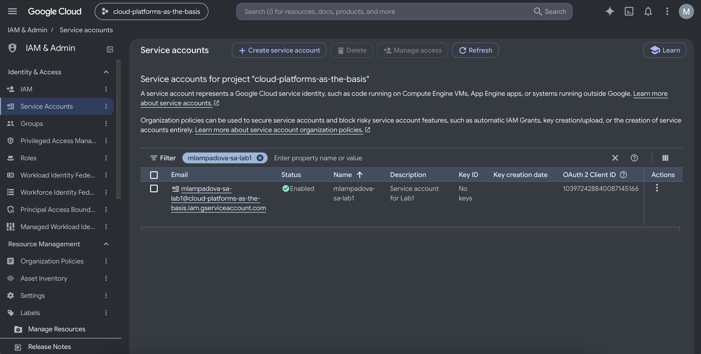
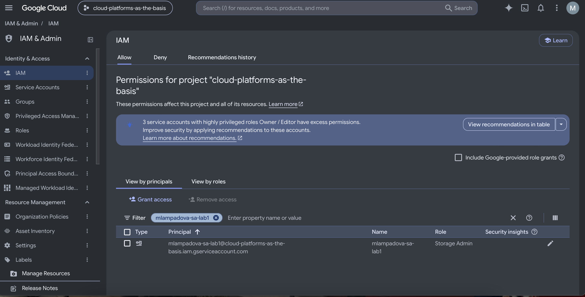
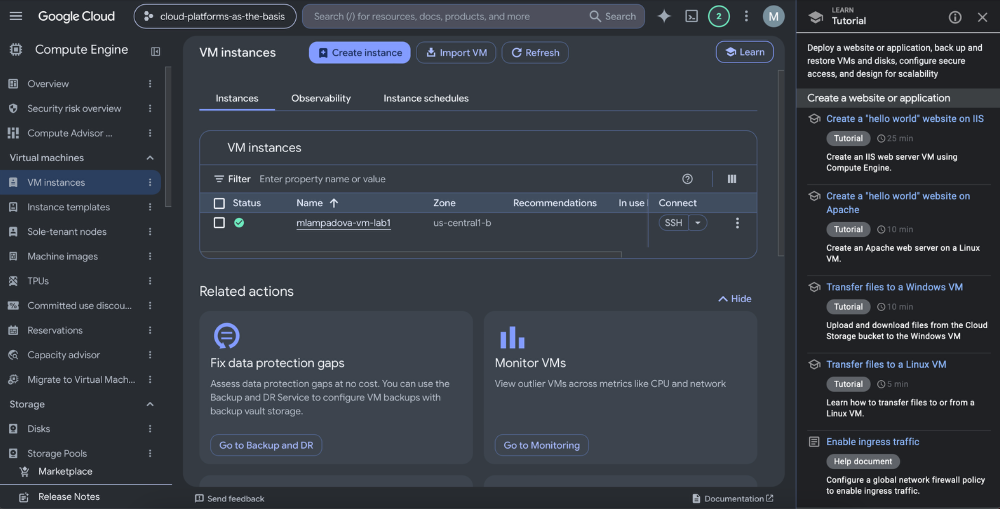
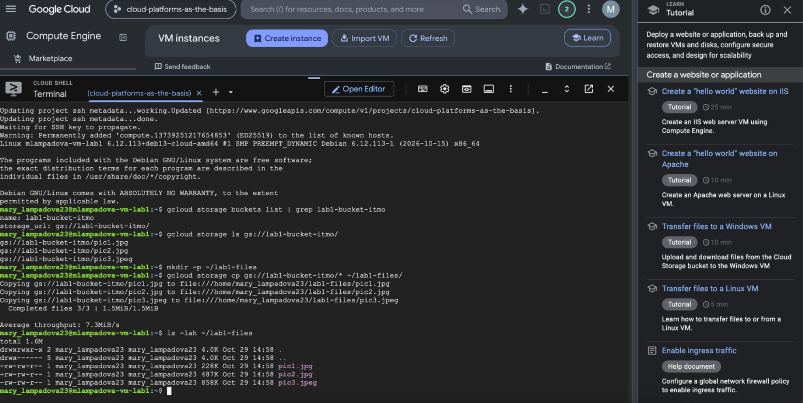
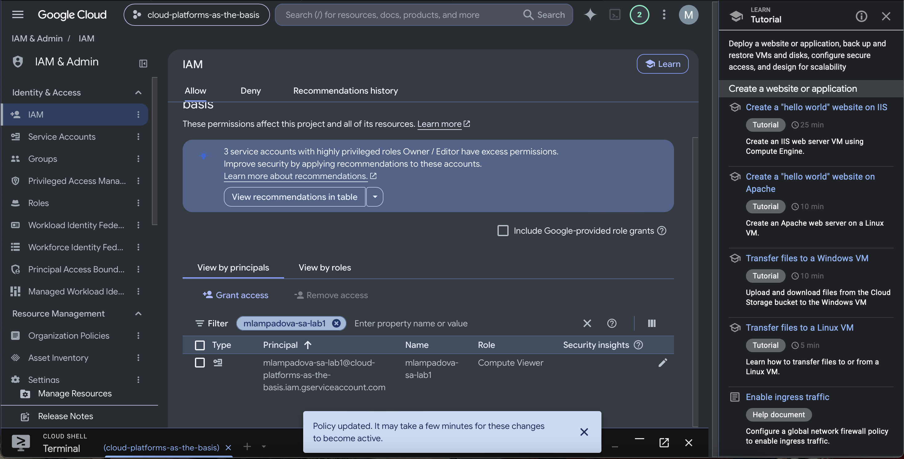
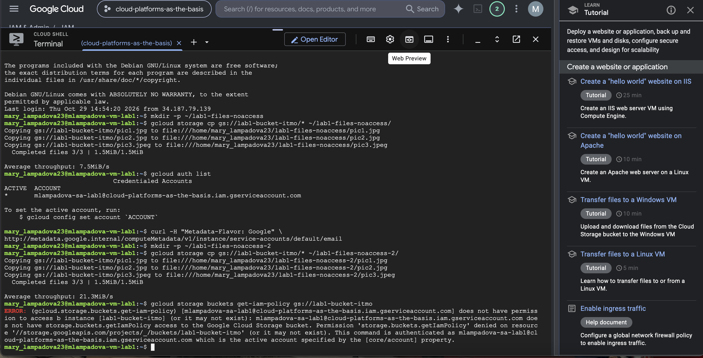
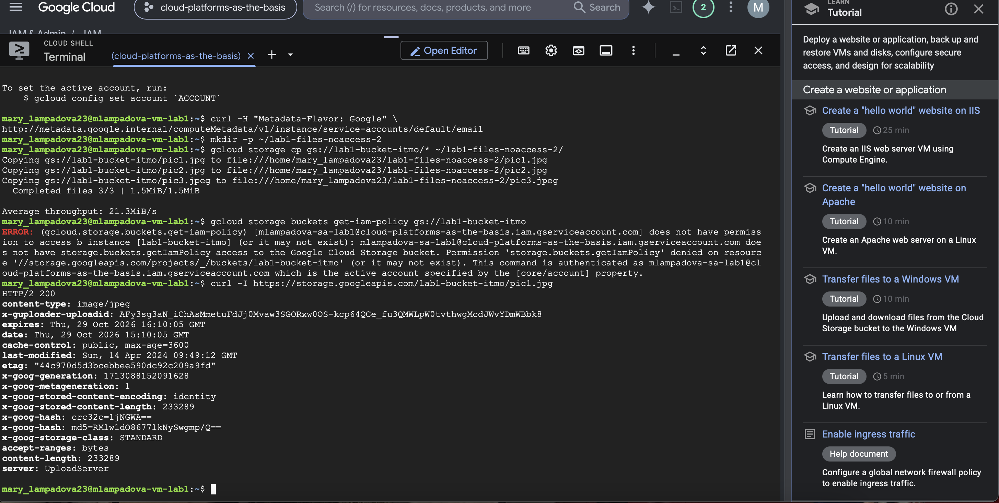
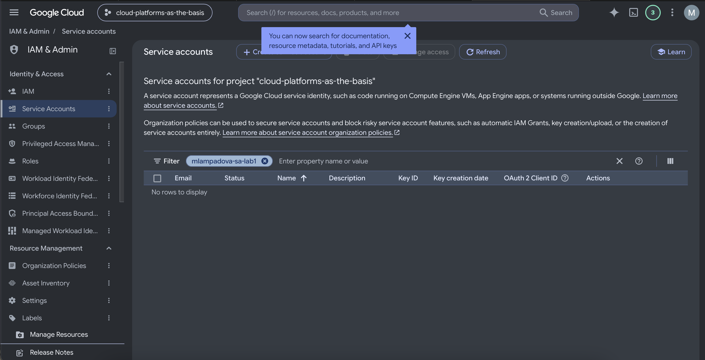
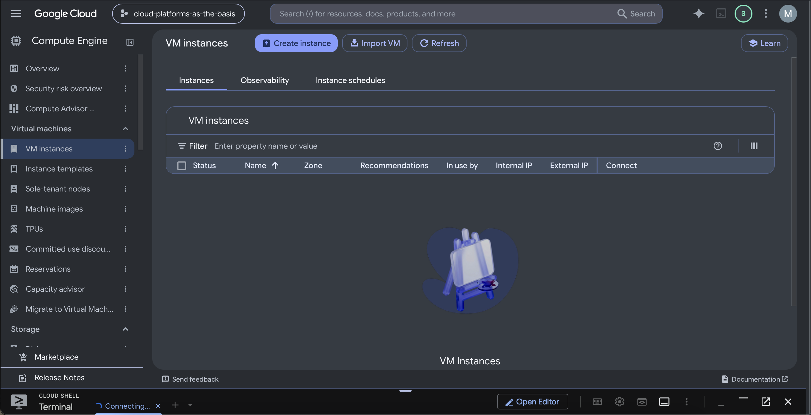

# Лабораторная работа №1
## Обзор Google Cloud и исследование основных сервисов

### Цель работы

Ознакомиться с основными возможностями Google Cloud, принципами работы IAM, service account, Compute Engine и Cloud Storage.

### Исходные данные

Для выполнения лабораторной работы использовался учебный проект:

`cloud-platforms-as-the-basis`

Были созданы:

- service account `mlampadova-sa-lab1`;
- виртуальная машина `mlampadova-vm-lab1`;
- тип виртуальной машины `e2-micro`;
- модель предоставления ресурсов `Spot`.

### 1. Создание service account

В разделе IAM & Admin был создан service account:

`mlampadova-sa-lab1`

После создания service account находился в статусе Enabled.

После этого service account была назначена роль:

`Storage Admin`

Эта роль дает права на работу с ресурсами Cloud Storage.

### 2. Создание виртуальной машины

В разделе Compute Engine была создана виртуальная машина:

`mlampadova-vm-lab1`

Для нее были выбраны:

- Machine type: `e2-micro`;
- регион: `us-central1`;
- provisioning model: `Spot`;
- service account: `mlampadova-sa-lab1`.

После создания виртуальная машина была успешно запущена.

### 3. Поиск бакета и копирование файлов

После подключения к виртуальной машине с помощью `gcloud` был найден бакет:

`lab1-bucket-itmo`

Для поиска использовалась команда:

`gcloud storage buckets list | grep lab1-bucket-itmo`

После этого было просмотрено содержимое бакета командой:

`gcloud storage ls gs://lab1-bucket-itmo/`

В бакете находились три файла:

- `pic1.jpg`;
- `pic2.jpg`;
- `pic3.jpeg`.

На виртуальной машине была создана локальная папка:

`~/lab1-files`

После этого все три файла были скопированы из Cloud Storage на VM командой:

`gcloud storage cp gs://lab1-bucket-itmo/* ~/lab1-files/`

Команда завершилась успешно:

`Completed files 3/3`

Для проверки наличия файлов использовалась команда:

`ls -lah ~/lab1-files`

В результате в локальной папке были отображены все три файла.

### 4. Изменение роли service account

После успешного копирования роль service account была изменена с:

`Storage Admin`

на:

`Compute Viewer`

### 5. Проверка доступа после смены роли

После смены роли service account с `Storage Admin` на `Compute Viewer` было повторно выполнено копирование файлов из бакета.

Несмотря на изменение роли, команда копирования файлов продолжила работать успешно.

Чтобы проверить, от имени какого аккаунта выполняются команды внутри VM, использовались:

`gcloud auth list`

и запрос к metadata server:

`curl -H "Metadata-Flavor: Google" http://metadata.google.internal/computeMetadata/v1/instance/service-accounts/default/email`

Обе проверки подтвердили, что VM действительно использует service account:

`mlampadova-sa-lab1@cloud-platforms-as-the-basis.iam.gserviceaccount.com`

После этого была выполнена команда получения IAM-политики бакета:

`gcloud storage buckets get-iam-policy gs://lab1-bucket-itmo`

Она завершилась ошибкой доступа:

`Permission denied`

Это подтвердило, что после смены роли service account больше не имеет прав на управление или просмотр IAM-политики Cloud Storage.

При этом сами файлы продолжали скачиваться. Для проверки был выполнен прямой HTTP-запрос к объекту:

`curl -I https://storage.googleapis.com/lab1-bucket-itmo/pic1.jpg`

Ответ:

`HTTP/2 200`

Это означает, что объект доступен публично по прямой ссылке, поэтому его чтение не требует прав `Storage Admin`.

### Вывод по проверке прав

Смена роли с `Storage Admin` на `Compute Viewer` действительно ограничила права service account на Cloud Storage: доступ к IAM-политике бакета был запрещрен.

Однако сами файлы продолжили скачиваться, потому что объекты в бакете доступны публично. Поэтому в данном случае проверка показала разницу между правами IAM на управление ресурсом и публичным доступом к отдельным объектам.

### 6. Удаление созданных ресурсов

После завершения лабораторной работы были удалены все созданные ресурсы.

Сначала была удалена виртуальная машина:

`mlampadova-vm-lab1`

После удаления список VM instances стал пустым.

Затем был удален service account:

`mlampadova-sa-lab1`

После удаления поиск по его имени в разделе Service Accounts больше не возвращал результатов.

### 7. Итоговый вывод

В ходе лабораторной работы были изучены базовые сервисы Google Cloud:

- IAM и роли доступа;
- service accounts;
- Compute Engine;
- Spot VM;
- Cloud Storage;
- утилита `gcloud`.

Была создана виртуальная машина `e2-micro` в режиме Spot и подключен service account с ролью `Storage Admin`.

С помощью `gcloud` был найден бакет `lab1-bucket-itmo`, после чего три файла были успешно скопированы на виртуальную машину.

После смены роли service account на `Compute Viewer` права на управление Cloud Storage были ограничены. При этом сами файлы продолжили скачиваться, так как оказались публично доступными по прямой ссылке.

В конце лабораторной работы созданные ресурсы были удалены.
