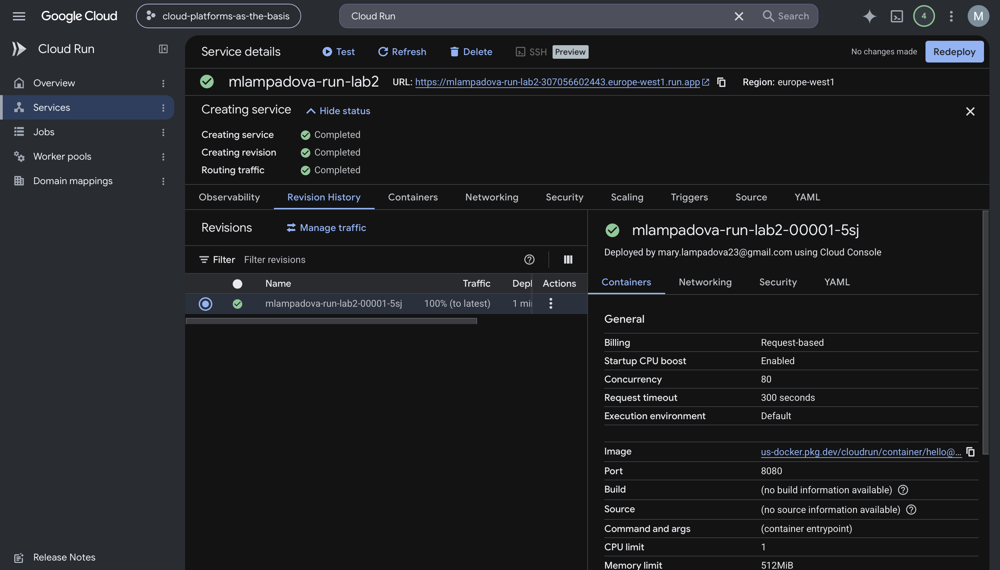
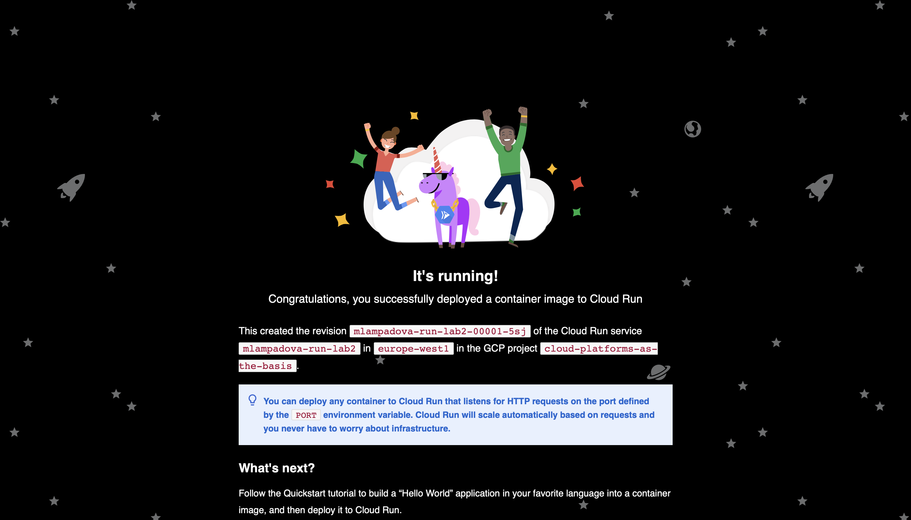
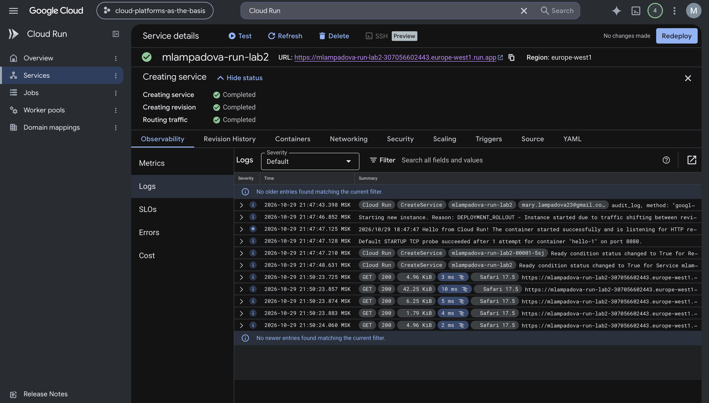
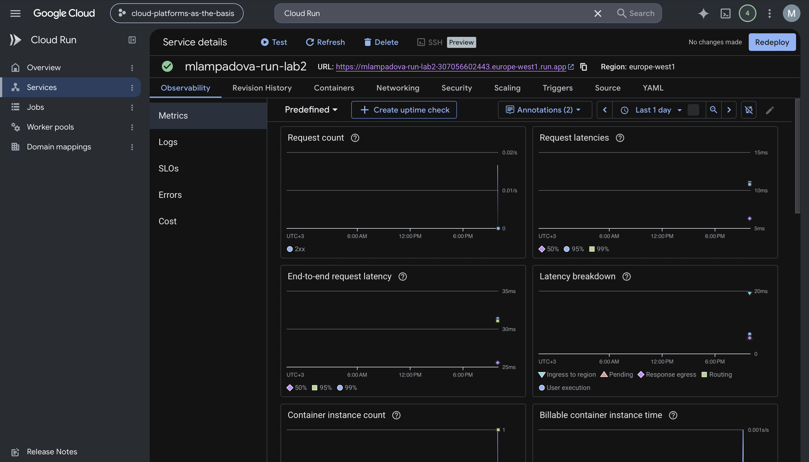
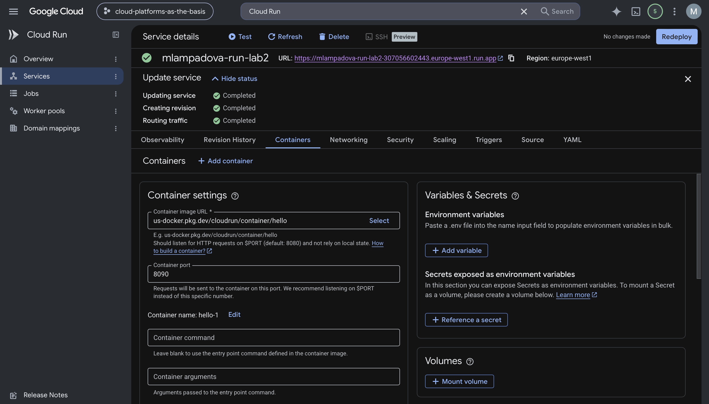
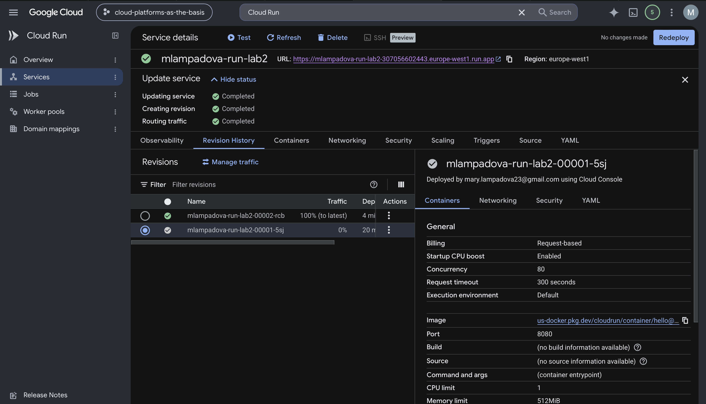
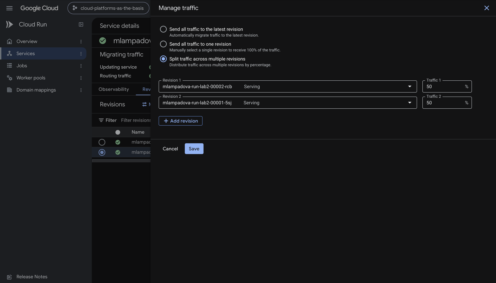
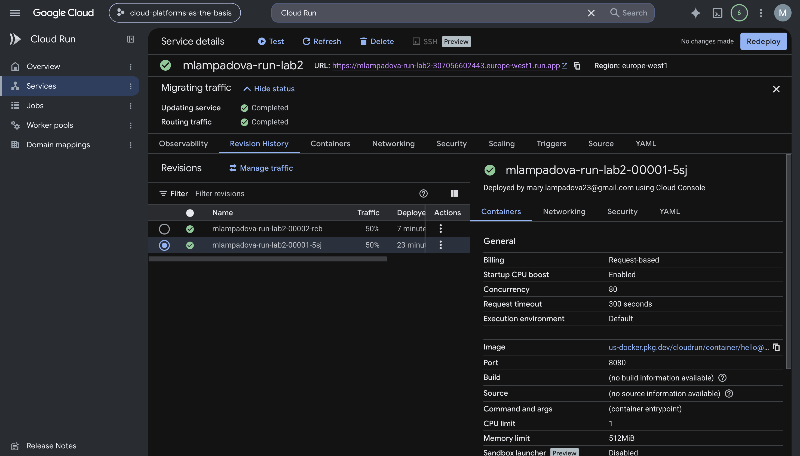
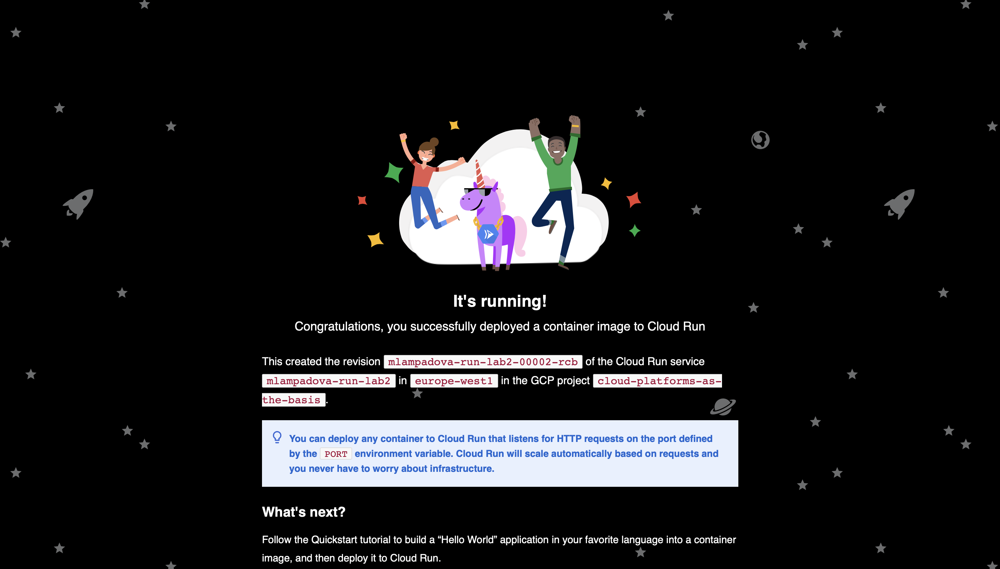
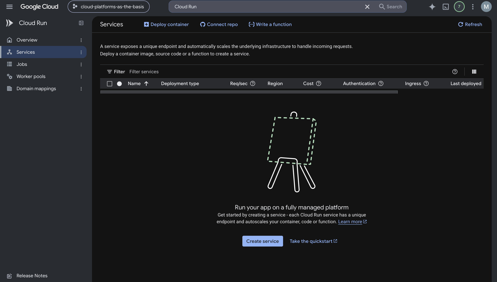

# Лабораторная работа №2
## Исследование Cloud Run

### Цель работы

Ознакомиться с работой Cloud Run, развертыванием контейнерного сервиса, просмотром логов и метрик, созданием новых ревизий и управлением трафиком между ними.

### Исходные данные

Для выполнения лабораторной работы использовался учебный проект:

`cloud-platforms-as-the-basis`

В Cloud Run был создан сервис:

`mlampadova-run-lab2`

Для сервиса использовался дефолтный sample-контейнер:

`us-docker.pkg.dev/cloudrun/container/hello`

Начальные параметры сервиса:

- регион: `europe-west1`;
- container port: `8080`;
- memory: `512 MiB`;
- CPU: `1`;
- minimum number of instances: `0`;
- autoscaling;
- request-based billing;
- public access.

### 1. Создание Cloud Run сервиса

В разделе Cloud Run был создан сервис `mlampadova-run-lab2`.

После создания первая ревизия сервиса успешно развернулась и получила 100% трафика.

После этого был открыт URL, предоставленный Cloud Run.

Сервис успешно ответил страницей `It's running!`, что подтвердило корректный запуск контейнера.

### 2. Анализ логов

После запуска сервиса был открыт раздел `Observability → Logs`.

В логах были зафиксированы:

- запуск нового экземпляра контейнера;
- успешный запуск контейнера Hello;
- успешная проверка `STARTUP TCP probe`;
- HTTP GET-запросы к сервису;
- ответы со статусом `200`.

Также в логах была видна небольшая задержка ответа — несколько миллисекунд.

### 3. Анализ метрик

После нескольких обращений к сервису были просмотрены метрики Cloud Run.

На панели отображались:

- количество запросов (`Request count`);
- задержка ответа (`Request latencies`);
- общая задержка запроса (`End-to-end request latency`);
- структура задержки (`Latency breakdown`);
- количество запущенных экземпляров контейнера (`Container instance count`);
- оплачиваемое время работы контейнера (`Billable container instance time`).

После нескольких запросов Cloud Run автоматически запустил один экземпляр контейнера для обработки трафика.

### 4. Изменение порта и создание новой ревизии

После проверки первоначальной версии сервиса была изменена настройка контейнера.

Порт был изменён с:

`8080`

на:

`8090`

После изменения конфигурации Cloud Run создал новую ревизию сервиса.

В результате в истории ревизий появились две версии:

- первая ревизия с портом `8080`;
- вторая ревизия с портом `8090`.

Новая ревизия автоматически получила 100% трафика.

Изменение порта не привело к ошибке, поскольку sample-контейнер Cloud Run использует значение порта, передаваемое через переменную окружения `PORT`.

Таким образом, контейнер смог корректно работать и после изменения порта на `8090`.

### 5. Управление трафиком между ревизиями

Для проверки механизма управления версиями трафик был распределён между двумя ревизиями сервиса.

Сначала было настроено распределение:

- первая ревизия с портом `8080` — `50%`;
- вторая ревизия с портом `8090` — `50%`.

После сохранения настроек в истории ревизий отображалось распределение трафика `50% / 50%`.

При нескольких обращениях по общему URL сервис продолжал работать корректно. Внешне обе версии выглядели одинаково, поскольку использовали один и тот же sample-контейнер Hello. Разница между ревизиями заключалась только в настройке порта.

После этого весь трафик был снова направлен на новую ревизию с портом `8090`.

В результате:

- новая ревизия получила `100%` трафика;
- старая ревизия получила `0%`.

После переключения трафика сервис был повторно открыт по URL и продолжил корректно работать.

### 6. Удаление сервиса

После завершения тестирования сервис Cloud Run был удалён.

Это позволило освободить созданные ресурсы и избежать лишнего использования облачной инфраструктуры.

### 7. Итоговый вывод

В ходе лабораторной работы был изучен сервис Google Cloud Run.

Был создан и успешно запущен контейнерный сервис на основе дефолтного Hello-контейнера.

В процессе работы были изучены:

- создание Cloud Run сервиса;
- запуск публичного контейнерного приложения;
- просмотр логов;
- анализ метрик;
- создание новых ревизий;
- изменение конфигурации контейнера;
- управление распределением трафика между ревизиями.

Изменение порта с `8080` на `8090` привело к созданию новой ревизии, при этом сервис продолжил работать корректно.

Также было протестировано распределение трафика между двумя ревизиями в пропорции `50/50` и последующее направление `100%` трафика на новую ревизию.

В конце лабораторной работы сервис Cloud Run был удалён.
