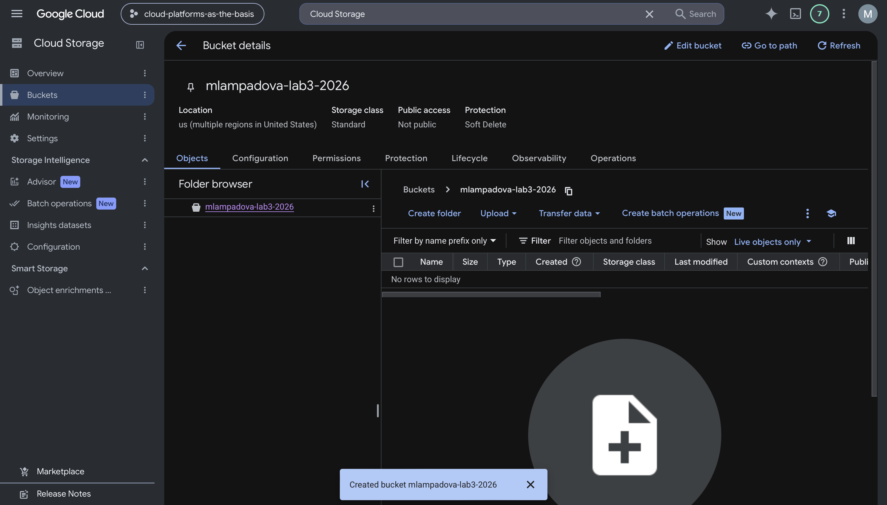
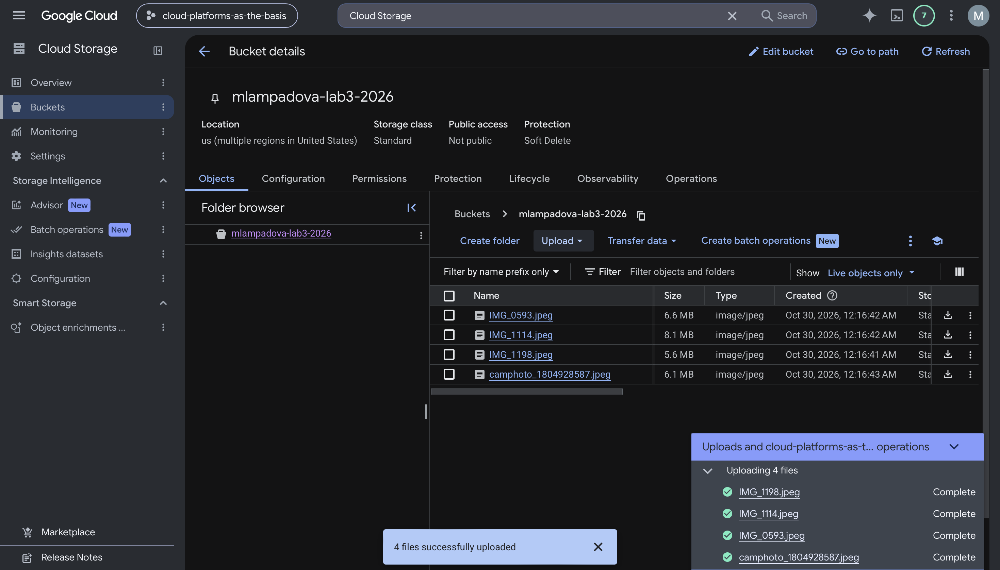
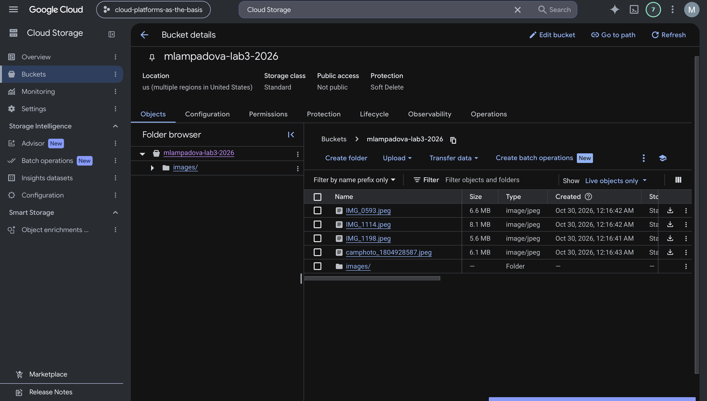
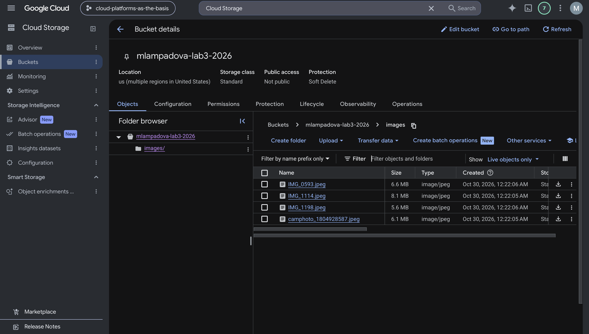
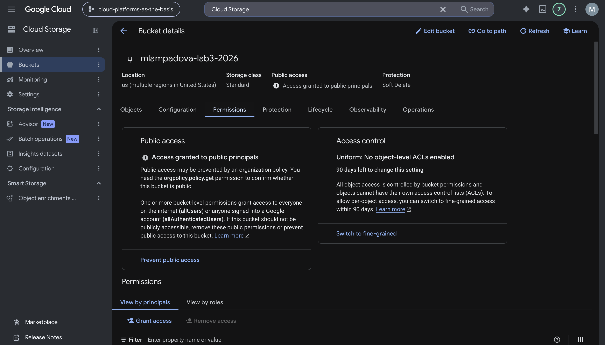
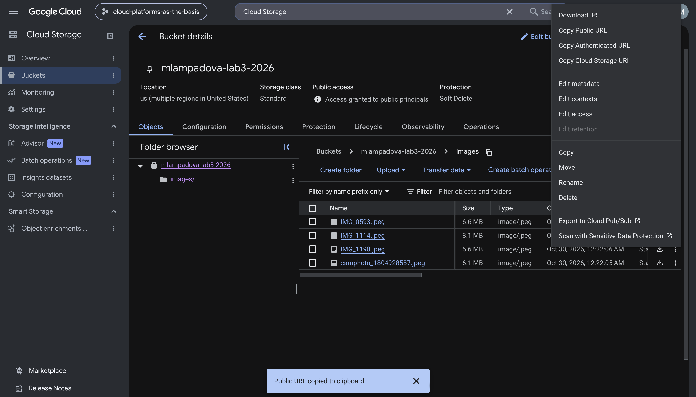
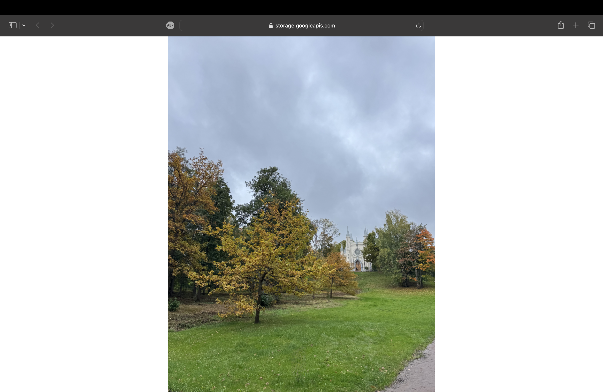
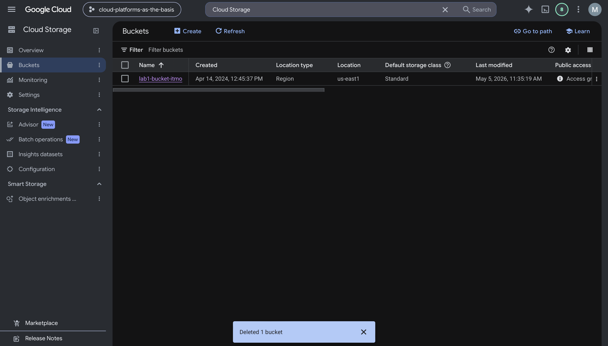

# Лабораторная работа №3
## Исследование Cloud Storage

### Цель работы

Ознакомиться с основными понятиями и принципами работы облачного хранилища, изучить работу объектного хранения данных и основные возможности Google Cloud Storage.

### Исходные данные

Для выполнения лабораторной работы использовался учебный проект:

`cloud-platforms-as-the-basis`

В Cloud Storage был создан bucket:

`mlampadova-lab3-2026`

Параметры bucket:

- Location: `us`;
- Location type: `Multi-region`;
- Storage class: `Standard`;
- Access control: `Uniform`;
- Public access prevention: отключён.

### 1. Создание Cloud Storage bucket

В разделе Cloud Storage был создан bucket:

`mlampadova-lab3-2026`

После создания bucket был доступен для дальнейшей работы с объектами.

### 2. Загрузка изображений

В bucket были загружены четыре изображения:

- `IMG_0593.jpeg`;
- `IMG_1114.jpeg`;
- `IMG_1198.jpeg`;
- `camphoto_1804928587.jpeg`.

После загрузки все четыре файла отображались в списке объектов bucket.

### 3. Создание папки и перемещение файлов

Внутри bucket была создана папка:

`images`

После этого все четыре изображения были перемещены из корня bucket в папку `images`.

Для перемещения использовалась команда:

`gcloud storage mv gs://mlampadova-lab3-2026/*.jpeg gs://mlampadova-lab3-2026/images/`

После выполнения команды все изображения находились внутри папки `images`.

### 4. Настройка публичного доступа

Для bucket был настроен публичный доступ к объектам.

В разделе `Permissions` для принципала:

`allUsers`

была назначена роль:

`Storage Object Viewer`

После применения политики в настройках bucket появился статус:

`Access granted to public principals`

### 5. Получение публичных ссылок

После настройки публичного доступа для одного из объектов через контекстное меню была выбрана команда:

`Copy Public URL`

В качестве примера была получена публичная ссылка:

`https://storage.googleapis.com/mlampadova-lab3-2026/images/IMG_0593.jpeg`

Работа ссылки была проверена отдельно: изображение открывалось без авторизации Google, что подтвердило корректную настройку публичного доступа.

Публичные URL остальных изображений были сохранены отдельно в файле:

`public_urls.txt`

### 6. Удаление bucket

После завершения лабораторной работы созданный bucket был удалён.

Это позволило очистить созданные ресурсы и завершить работу с Cloud Storage.

### 7. Итоговый вывод

В ходе лабораторной работы был изучен сервис Google Cloud Storage и основные принципы объектного хранения данных.

В процессе работы были выполнены следующие действия:

- создан Cloud Storage bucket;
- загружены четыре изображения;
- создана папка `images`;
- файлы были перемещены внутрь этой папки;
- для объектов был настроен публичный доступ через принципал `allUsers`;
- была назначена роль `Storage Object Viewer`;
- были получены публичные URL файлов;
- работа публичной ссылки была проверена без авторизации;
- после завершения работы bucket был удалён.

Лабораторная работа показала, как в Cloud Storage организуется объектное хранение, как управлять структурой объектов внутри bucket и как настраивать публичный доступ к отдельным файлам через IAM-права на уровне bucket.
