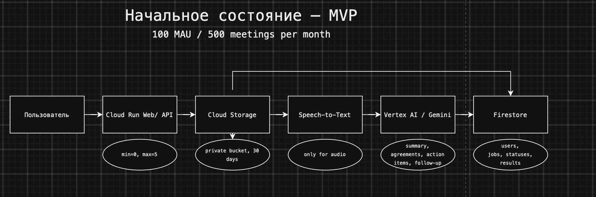
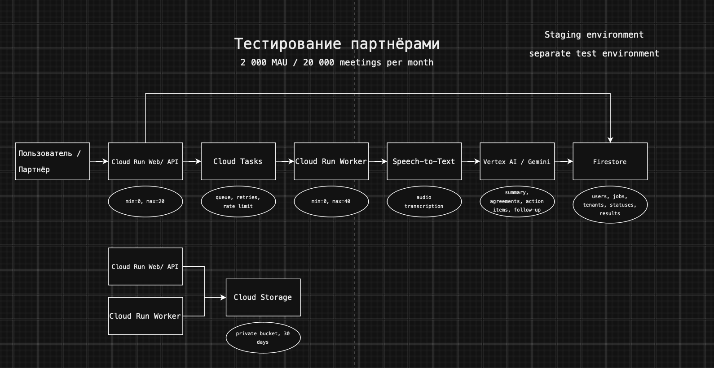
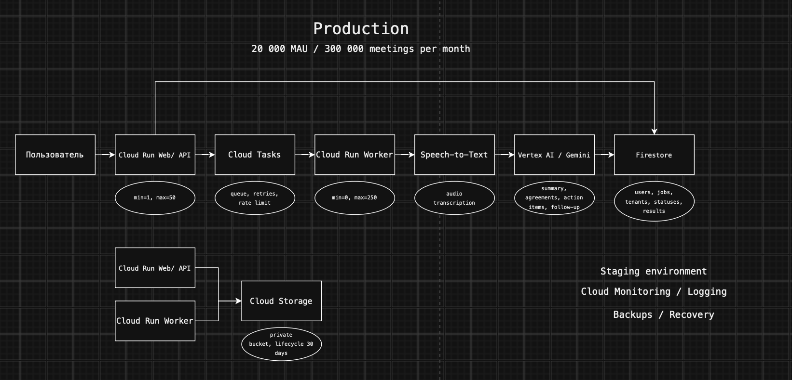

# Лабораторная работа №4
## Разработка инфраструктуры MVP AI приложения

### Цель работы

Спроектировать инфраструктуру MVP AI-приложения для трёх этапов развития: начального состояния, тестирования партнёрами и промышленной эксплуатации. Определить используемые облачные сервисы, обосновать их выбор и оценить ежемесячные расходы на содержание инфраструктуры.

### 1. Описание приложения

В рамках лабораторной работы проектируется AI-приложение для обработки записей деловых встреч.

Пользователь может загрузить аудиозапись встречи из Zoom, Microsoft Teams, Google Meet или другой платформы либо готовый текстовый транскрипт.

После обработки система формирует:

- краткое содержание встречи;
- основные договорённости;
- список action items;
- ответственных и сроки, если они были названы во время встречи;
- готовый follow-up для отправки участникам.

Если пользователь загружает аудиофайл, сначала выполняется преобразование речи в текст. Если загружается готовый транскрипт, этот этап пропускается.

На этапе MVP не предусматриваются автоматическое подключение к онлайн-встрече, live transcription, обучение собственной AI-модели и автоматическая интеграция с Zoom, Teams или Google Meet.

### 2. Исходные допущения

Для расчёта инфраструктуры приняты следующие значения:

| Параметр | Начальное состояние | Тестирование партнёрами | Production |
|---|---:|---:|---:|
| Активных пользователей в месяц | 100 | 2 000 | 20 000 |
| Обработанных встреч в месяц | 500 | 20 000 | 300 000 |
| Средняя длительность встречи | 30 минут | 30 минут | 30 минут |
| Доля загрузок аудио | 50% | 60% | 70% |
| Доля готовых транскриптов | 50% | 40% | 30% |
| Средний размер аудиофайла | 30 MB | 30 MB | 30 MB |
| Срок хранения файлов | 30 дней | 30 дней | 30 дней |

Эти значения являются проектными допущениями и используются для сравнения трёх состояний инфраструктуры и оценки расходов.

### 3. Архитектура приложения

Для приложения спроектированы три состояния инфраструктуры: начальный MVP, тестирование партнёрами и production.

#### 3.1. Начальное состояние — MVP

На первом этапе используется минимальная serverless-архитектура.

Основные компоненты:

- Cloud Run Web/API — пользовательский интерфейс и API приложения;
- Cloud Storage — приватное хранение аудиофайлов и транскриптов;
- Speech-to-Text — преобразование аудиозаписи в текст;
- Vertex AI / Gemini — анализ транскрипта и формирование результата;
- Firestore — хранение пользователей, заданий, статусов и результатов.

Cloud Run настроен с `min=0` и `max=5`, поэтому при отсутствии нагрузки сервис может масштабироваться до нуля. Это позволяет снизить расходы на начальном этапе.

Если пользователь загружает готовый транскрипт, этап Speech-to-Text пропускается.

#### 3.2. Тестирование партнёрами

При росте нагрузки обработка отделяется от пользовательского Web/API.

В архитектуру добавляются:

- Cloud Tasks — очередь заданий, повторные попытки и ограничение скорости обработки;
- отдельный Cloud Run Worker — выполнение тяжёлых операций обработки;
- staging environment — отдельное тестовое окружение.

Cloud Run Web/API масштабируется в диапазоне `min=0, max=20`, а Worker — `min=0, max=40`.

Cloud Storage остаётся единым приватным хранилищем. Web/API организует загрузку файлов, а Worker получает их из Storage для обработки.

Firestore дополнительно хранит информацию о партнёрах и tenant.

#### 3.3. Production

На production-этапе сохраняется та же базовая архитектура, однако увеличиваются пределы масштабирования и добавляются механизмы эксплуатации и восстановления.

Cloud Run Web/API работает с `min=1, max=50`. Один минимальный экземпляр позволяет уменьшить влияние cold start на пользователей.

Cloud Run Worker масштабируется в диапазоне `min=0, max=250`.

Дополнительно используются:

- Cloud Monitoring и Cloud Logging для контроля ошибок, задержек и нагрузки;
- staging environment для проверки изменений до production;
- backup и recovery для восстановления данных;
- lifecycle policy Cloud Storage с хранением файлов в течение 30 дней.

### 4. Экономическая модель

Расчёт выполняется для одного месяца работы приложения. Все суммы являются прогнозными и могут отличаться от фактического счёта Google Cloud в зависимости от региона, используемых квот, фактической длительности записей и объёма генерируемого текста.

Для расчёта приняты следующие дополнительные допущения:

- средняя длительность встречи — 30 минут;
- средний транскрипт одной встречи — около 6 000 входных токенов;
- средний AI-результат — около 800 выходных токенов;
- средний размер аудиофайла — 30 MB;
- файлы хранятся 30 дней;
- для AI используется Gemini 3.5 Flash-Lite;
- Speech-to-Text вызывается только для встреч, загруженных в формате аудио.

#### 4.1. Speech-to-Text

Основная статья расходов приложения связана с транскрибацией аудиозаписей.

Стоимость Speech-to-Text принята равной $0.016 за минуту.

**Начальное состояние:**

500 встреч × 50% аудио × 30 минут = 7 500 минут.

Стоимость:

`7 500 × $0.016 = $120 в месяц`

**Тестирование партнёрами:**

20 000 встреч × 60% аудио × 30 минут = 360 000 минут.

Стоимость:

`360 000 × $0.016 = $5 760 в месяц`

**Production:**

300 000 встреч × 70% аудио × 30 минут = 6 300 000 минут.

Стоимость:

`6 300 000 × $0.016 = $100 800 в месяц`

#### 4.2. Vertex AI / Gemini

Для одной встречи предполагается около 6 000 входных и 800 выходных токенов.

Ориентировочная стоимость одного AI-запроса составляет:

`6000 × $0.15 / 1 000 000 + 800 × $1.25 / 1 000 000 ≈ $0.0019`

Получаем:

- начальное состояние: около **$0.95/месяц**;
- тестирование партнёрами: около **$38/месяц**;
- production: около **$570/месяц**.

#### 4.3. Cloud Storage

В Cloud Storage хранятся аудиофайлы и связанные результаты обработки.

Ориентировочный объём аудио:

- начальное состояние — около 7.3 GiB;
- тестирование партнёрами — около 352 GiB;
- production — около 6 152 GiB.

При использовании Standard Storage ориентировочная стоимость составит:

- начальное состояние — **$0.14/месяц**;
- тестирование партнёрами — **$6.93/месяц**;
- production — **$121.36/месяц**.

#### 4.4. Cloud Run, Firestore и Cloud Tasks

Расходы на Cloud Run, Firestore и Cloud Tasks существенно ниже стоимости транскрибации.

Cloud Run оплачивается по фактическому времени использования ресурсов. На начальном и партнёрском этапах экземпляры могут масштабироваться до нуля.

Cloud Tasks используется начиная с этапа тестирования партнёрами. Для каждого задания учитывается создание задачи и её доставка Worker.

Firestore используется для хранения метаданных, статусов и результатов обработки.

Ориентировочная совокупная стоимость этих сервисов:

- начальное состояние — менее **$1/месяц**;
- тестирование партнёрами — около **$2/месяц**;
- production — около **$36/месяц**, включая один постоянно доступный минимальный экземпляр Web/API.

#### 4.5. Итоговая стоимость

| Статья расходов, USD/месяц | Начальное состояние | Тестирование партнёрами | Production |
|---|---:|---:|---:|
| Speech-to-Text | 120.00 | 5 760.00 | 100 800.00 |
| Vertex AI / Gemini | 0.95 | 38.00 | 570.00 |
| Cloud Storage | 0.14 | 6.93 | 121.36 |
| Cloud Run, Firestore, Tasks | 0.02 | 1.73 | 35.64 |
| **Итого** | **121.11** | **5 806.66** | **101 527.00** |
| Резерв 20% | 24.22 | 1 161.34 | 20 305.40 |
| **Плановый бюджет** | **145.33** | **6 968.00** | **121 832.40** |

Расчёт показывает, что основной статьёй расходов является Speech-to-Text. Поэтому при росте приложения именно объём обрабатываемого аудио оказывает наибольшее влияние на экономическую модель.

Использование готовых транскриптов существенно снижает себестоимость обработки встречи, так как в этом случае приложение оплачивает только AI-анализ текста и связанные облачные сервисы.

Это также означает, что при развитии продукта одним из способов оптимизации расходов может быть стимулирование пользователей загружать готовые транскрипты либо использование более экономичных режимов пакетной транскрибации.

### 5. Обоснование выбора ресурсов

Для инфраструктуры были выбраны управляемые облачные сервисы Google Cloud, которые позволяют начать с небольшой нагрузки и масштабировать приложение без полного изменения архитектуры.

| Сервис | Обоснование выбора |
|---|---|
| Cloud Run | Подходит для Web/API и Worker, поддерживает автоматическое масштабирование и scale-to-zero. Это позволяет снизить расходы на MVP и увеличивать количество экземпляров при росте нагрузки |
| Cloud Storage | Используется для хранения аудиозаписей, транскриптов и результатов. Объектное хранилище подходит для файлов большого размера и поддерживает lifecycle policy |
| Speech-to-Text | Позволяет автоматически преобразовывать аудиозаписи встреч в текст без необходимости разворачивать собственную модель распознавания речи |
| Vertex AI / Gemini | Используется для анализа транскрипта и формирования summary, договорённостей, action items и follow-up. Нет необходимости содержать собственную GPU-инфраструктуру |
| Firestore | Подходит для хранения пользователей, заданий, статусов обработки и результатов. Не требует отдельного администрирования базы данных |
| Cloud Tasks | Начиная с партнёрского этапа используется для очереди заданий, повторных попыток и ограничения скорости обработки |
| Cloud Monitoring / Logging | В production позволяет отслеживать ошибки, задержки, нагрузку и состояние сервисов |
| Backups / Recovery | Необходимы на production-этапе для снижения риска потери пользовательских данных |

На начальном этапе намеренно не используются виртуальные машины, GKE и собственные GPU. Для предполагаемой нагрузки их постоянные расходы и эксплуатационная сложность не оправданы.

Выбранная архитектура сохраняет основные компоненты при переходе между этапами. На партнёрском этапе к базовой системе добавляются очередь и отдельный Worker, а в production увеличиваются пределы масштабирования и добавляются инструменты эксплуатации и восстановления.

Таким образом, развитие приложения не требует полного переписывания инфраструктуры.

### 6. Итоговый вывод

В ходе лабораторной работы была разработана инфраструктура MVP AI-приложения для анализа записей деловых встреч.

Были рассмотрены три стадии развития:

- начальное состояние;
- тестирование партнёрами;
- production.

Для каждой стадии определены предполагаемая нагрузка, архитектура и параметры масштабирования.

В основе решения используются Cloud Run, Cloud Storage, Speech-to-Text, Vertex AI / Gemini и Firestore. При росте нагрузки добавляются Cloud Tasks, отдельный Worker, staging environment, Monitoring, Logging и механизмы восстановления данных.

Экономическая модель показала, что стоимость инфраструктуры растёт прежде всего из-за обработки аудиозаписей через Speech-to-Text. Хранение данных, Cloud Run и база метаданных занимают значительно меньшую долю расходов.

Плановый месячный бюджет с резервом 20% составляет:

- начальное состояние — около **$145**;
- тестирование партнёрами — около **$6 968**;
- production — около **$121 832**.

Выбранная архитектура позволяет начать с относительно простой serverless-конфигурации и постепенно масштабировать её без замены основных компонентов системы.
